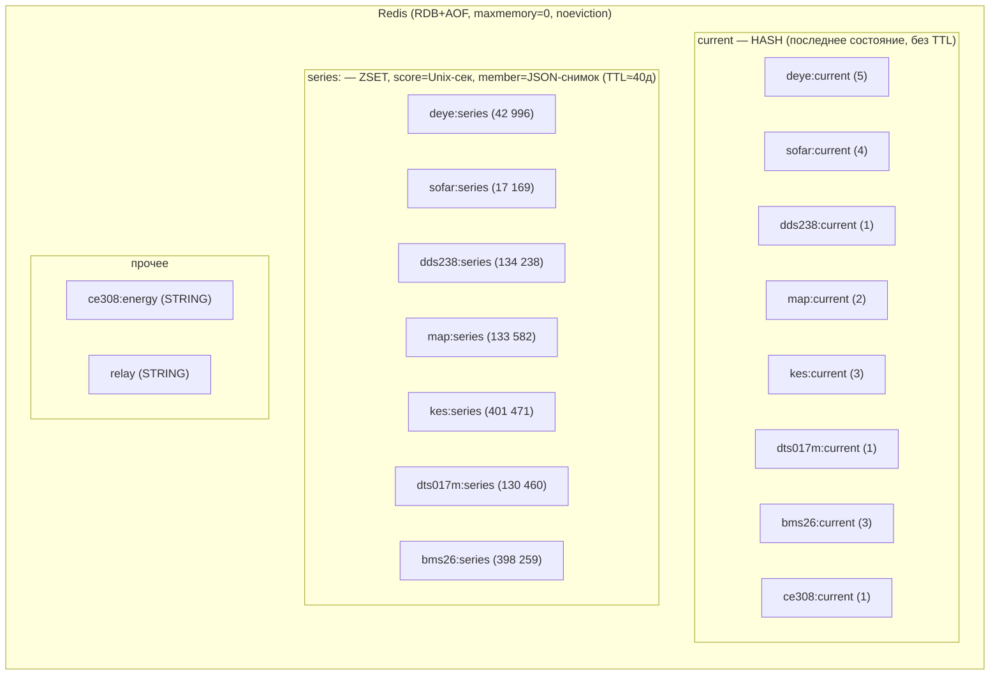
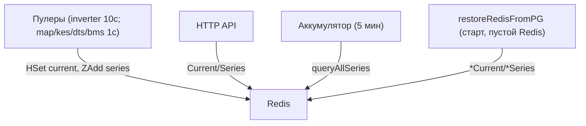
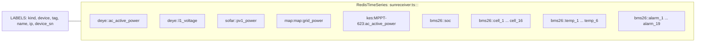
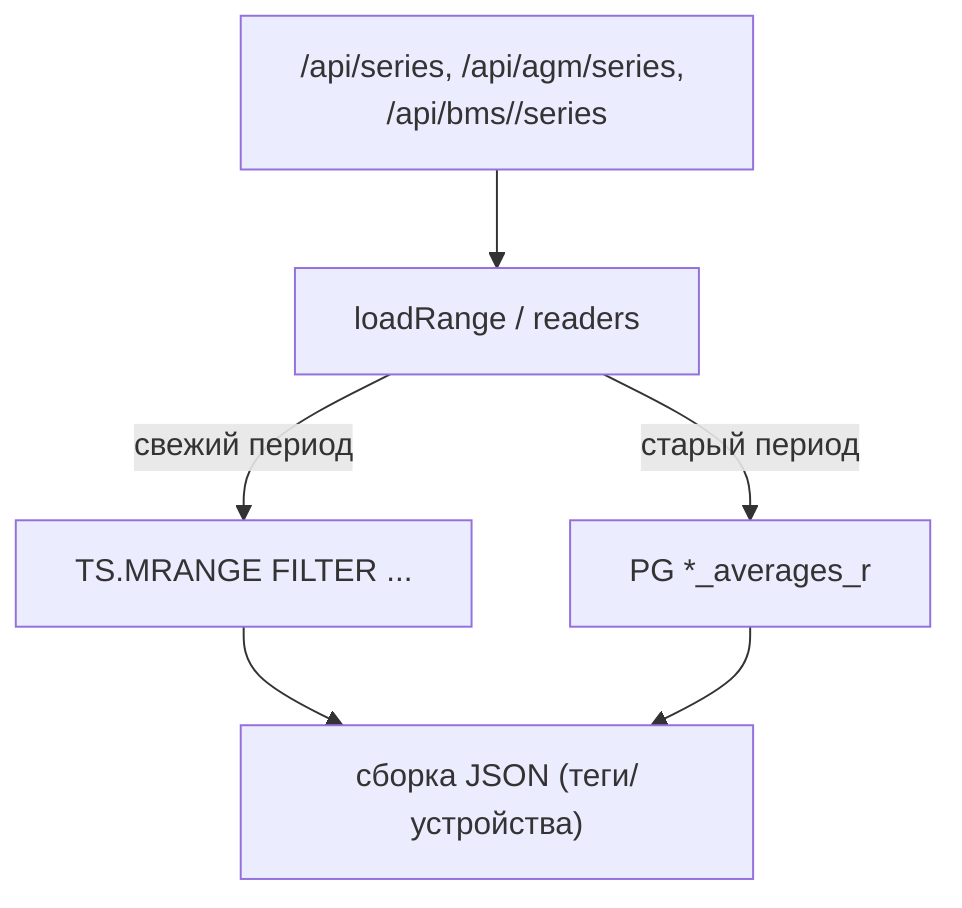

# Redis: оптимизация хранилища — сбор требований (AS IS)

Статус: **сбор требований**. Разработка — только по отмашке. Ничего не менять до
согласования. Документ фиксирует ТЕКУЩУЮ раскладку данных в Redis, методы выборки и
проблемы производительности; далее — открытые вопросы к заказчику.

Снято с прода 2026-10-16. `used_memory ≈ 756 МБ`, `peak ≈ 1.25 ГБ`,
`maxmemory=0`, `maxmemory_policy=noeviction`. Всего 17 ключей.

## 1. AS IS — раскладка ключей



Писатели (пулеры) -> `current` (HGET/HSet) + `series` (ZADD); 5-мин средние идут в
PostgreSQL (`*_averages_r`). Redis хранит **каждое снятое показание** за последние
2 календарных суток (очистка `PurgeOld`); TTL 40 суток — формальный предохранитель.

| Ключ | Тип | TTL | Card | Mem | Назначение |
|---|---|---:|---:|---:|---|
| `sunreceiver:deye:current` | hash | ∞ | 5 | 3.5 KB | текущий снимок (поле = серийник) |
| `sunreceiver:sofar:current` | hash | ∞ | 4 | 2.9 KB | то же |
| `sunreceiver:dds238:current` | hash | ∞ | 1 | 0.5 KB | текущий снимок счётчика |
| `sunreceiver:map:current` | hash | ∞ | 2 | 1 KB | текущий МАП |
| `sunreceiver:kes:current` | hash | ∞ | 3 | 1.2 KB | текущие КЭС |
| `sunreceiver:dts017m:current` | hash | ∞ | 1 | 1.2 KB | текущий DTS017M |
| `sunreceiver:bms26:current` | hash | ∞ | 3 | 2.6 KB | текущие BMS |
| `sunreceiver:ce308:current` | hash | ∞ | 1 | 0.7 KB | текущий CE308 |
| `sunreceiver:deye:series:2026-10` | zset | ~40 д | 42 996 | 28.8 MB | ряд инверторов Deye |
| `sunreceiver:sofar:series:2026-10` | zset | ~40 д | 17 169 | 11.7 MB | ряд Sofar |
| `sunreceiver:dds238:series:2026-10` | zset | ~40 д | 134 238 | 57.3 MB | ряд DDS238 |
| `sunreceiver:map:series:2026-10` | zset | ~40 д | 133 582 | 59.4 MB | ряд МАП |
| `sunreceiver:kes:series:2026-10` | zset | ~40 д | 401 471 | 146.9 MB | ряд КЭС (3 контроллера) |
| `sunreceiver:dts017m:series:2026-10` | zset | ~40 д | 130 460 | 166.8 MB | ряд DTS017M |
| `sunreceiver:bms26:series:2026-10` | zset | ~40 д | 398 259 | 333.4 MB | ряд BMS (3 шт) |
| `sunreceiver:ce308:energy` | string | ∞ | 555 B | — | энергоснимок CE308 → **переименовать** в `sunreceiver:ce308-energy:current` (решение) |
| `sunreceiver:relay` | string | ∞ | 73 B | — | состояние ламп SR-201 → **удалить** (write-only рудимент, решение) |

Наблюдения: `member` = **полный JSON-снимок** (≈0.36–1.28 КБ), ключи тегов
повторяются в каждом элементе; самый тяжёлый — `bms26:series` (333 МБ / 398 259
элементов ≈ **838 Б/элемент**), `dts017m:series` ≈ **1278 Б/элемент**.

## 2. AS IS — методы выборки (кто читает Redis)



| Метод (redisStore) | Модуль | Паттерн |
|---|---|---|
| `invCurrent` / `queryInvSeries` | deye/sofar | `HGETALL`; `ZRANGEBYSCORE` по месячному ключу |
| `MapCurrent` / `QueryMapSeries` | МАП | то же |
| `Dds238Current` / `QueryDds238Series` | DDS238 | то же |
| `KesCurrent` / `QueryKesSeries` | КЭС | `HGETALL`; `ZRANGEBYSCORE` |
| `Dts017Current` / `QueryDts017Series` | DTS017M | то же |
| `Bms26Current` / `Bms26One` / `QueryBms26Series` | BMS | `HGETALL`; `ZRANGEBYSCORE` + **фильтр по serial в Go** |
| `CE308Current` / `QueryCE308Series` | CE308 | current + (в режиме `final_readings_only` ряд не пишется) |
| `CurrentOne` | уведомления/лампы | точечный `HGET` |
| `queryAllSeries` | накопитель/бэкфилл | сумма по всем модульным рядам за окно |

Потребители (HTTP API):
- `GET /api/current`, `/api/animation` — `allCurrent()` (current всех модулей).
- `GET /api/series` — `loadRange` (PG старая часть + Redis свежее окно; single-flight 5 с).
- `GET /api/agm/series` — `mapSeriesRange` + BMS (`Bms26Averages`).
- `GET /api/bms/<serial>/series` — `QueryBms26Series` (+ PG).
- `GET /api/dts017m/*`, `/api/ce308/*` — соответствующие current/серии.

## 3. AS IS — проблемы производительности

- **П1. Память и риск OOM.** ~756 МБ за ~2 суток, пик 1.25 ГБ, `maxmemory=0` +
  `noeviction` → рост не ограничен; при превышении свободной RAM возможен OOM-kill.
  Нет мониторинга/лимита.
- **П2. Формат хранения.** `member` — полный JSON снимок на **каждое** показание:
  повторяющиеся имена тегов, отсутствие компактной/бинарной упаковки → 0.36–1.28 КБ
  на точку; для BMS — до ~838 Б.
- **П3. Частота/гранулярность.** Ряды хранят сырьё: инверторы ~10 с, МАП/КЭС/DTS/BMS
  ~1 с → миллионы элементов на 2 суток (bms26 398k, kes 401k).
- **П4. Чтение (дашборд).** `ZRANGEBYSCORE` за окно возвращает все JSON-элементы, в Go
  — `json.Unmarshal` по каждому; для суток/2 суток это большой объём и CPU/GC.
  `loadRange` смягчён single-flight (5 с), но каждый новый диапазон пересчитывается.
- **П5. Нет ключа по устройству.** Модульный ряд — один ZSET на все устройства
  (напр. `bms26:series` на 3 BMS; `kes:series` на 3 КЭС) → выборка одного устройства
  (`QueryBms26Series(serial)`) фильтрует **в Go** (O(N) по всему окну).
- **П6. TTL/очистка.** TTL 40 суток при фактическом удержании 2 суток почти не
  работает как предохранитель; очистка — `ZREMRANGEBYSCORE` по каждому ключу
  (фоновый `PurgeOld`, 15 мин).
- **П7. Персистентность.** Каждое показание → запись в AOF/RDB; большой объём и
  частые мелкие записи увеличивают AOF и нагрузку `fsync`.
- **П8. Дублирование.** Сырьё в Redis (2 суток) + 5-мин средние в PG — два
  независимых хранилища одной телеметрии.

## 4. Требования (заполнить/согласовать)

Открытые вопросы к заказчику (нужно для проектирования):

1. **Целевое удержание сырья в Redis** — оставить 2 суток? иные окна по модулям?
2. **Нужна ли сырьевая гранулярность 1–2 с** в Redis, или достаточно, например,
   10–60 с / 5-мин для графиков и текущего состояния?
3. **Бюджет памяти** Redis на проде (жёсткий лимит/`maxmemory`+`eviction`?) и
   приемлемое поведение при переполнении.
4. **Формат хранения**: остаётся JSON, или допустимо компактнее (per-device ключи,
   бинарная упаковка member, Hash-поля, Streams, RediSearch/RedisTimeSeries module)?
5. **Ключевание**: перейти на **per-device ряд** (ключ включает серийник/имя), чтобы
   выборка одного устройства была O(окно), а не O(весь ряд)?
6. **Целевые SLA чтения**: p95 для `/api/series` (сутки/30д/365д) и
   `/api/bms/<serial>/series`; нагрузка (RPS/одновременность).
7. **Персистентность**: требования к RDB/AOF (нужен ли AOF `everysec`?).
8. **Совместимость**: контракт JSON фронта и `/api/*` менять нельзя (или можно?).

## 5. Направления для обсуждения (варианты, НЕ решения)

- **Per-device ряды** (`...:series:<device>:<YYYY-MM>`): точечная выборка O(окно),
  устранение фильтра в Go (П5).
- **Компактный member**: бинарная упаковка/числовые колонки вместо JSON (П2);
  либо Redis Streams с полями.
- **Снижение гранулярности** сырья в Redis (П3) — если SLA графиков позволяет.
- **Иной бэкенд**: RedisTimeSeries (сжатие, downsampling, retention) при допустимости
  модуля.
- **Политики**: лимит памяти + eviction, ревизия TTL/PurgeOld (П1/П6), настройки AOF (П7).

## 6. Метрики для приёмки (предварительно)
- Память Redis (RSS/`used_memory`) при целевом удержании и частоте опроса.
- p95/p99 времени `ZRANGEBYSCORE`-выборки и `/api/series`, `/api/bms/<serial>/series`.
- CPU/GC при чтении диапазона; объём AOF/RDB; отсутствие OOM при лимите памяти.

## 7. Принятые решения (покомпонентно; разработка — по отмашке)

- **`sunreceiver:ce308:energy`** → **переименовать** в
  **`sunreceiver:ce308-energy:current`** (единый стиль `*:current`). Ключ нужен:
  планировщик снимков CE308 (`ce308EnergyDelay`) и панель `GET/POST /api/ce308/energy`.
  В разработке: сменить константу `redisCE308EnergyKey` (`ce308_store.go`) +
  миграцию значения (перенести один снимок old→new).
- **`sunreceiver:relay`** → **удалить**. Ключ write-only (пишется `relayController.persist`),
  никем не читается; `/api/relay` отдаёт состояние из памяти (`controller.Snapshot`).
  В разработке: удалить константу `redisRelayKey`, `persistLocked`/`persist` и вызовы;
  из доков (`docs/relay_sr-201(2light).md`) убрать упоминание ключа.

## 8. Целевое решение `series`: RedisTimeSeries (вариант B)

Принято. Redis на проде **8.10.1**, модуль **RedisTimeSeries** присутствует
(`redistimeseries.so`, `TS.ADD`); модули Redis 8 бесплатны (self-hosted, AGPLv3).
Окно хранения (~2 суток) и сырьевая гранулярность сохраняются.

### 8.1 Модель данных
Серия — на пару **(устройство, тег)**. Метки (`LABELS`) обеспечивают выборку по
устройству/тегу/марке, в т.ч. кросс-устройственную.



- Ключ: `sunreceiver:ts:<kind>:<device>:<tag>`; `<device>` — логический ключ
  (серийник для инверторов/BMS, имя для map/dds238/kes/dts), небезопасные символы
  (пробелы и т.п.) заменяются на `_`.
- `LABELS`: `kind` (`deye|sofar|dds238|map|kes|dts017m|bms26|ce308`), `device`
  (исходный логический ключ), `tag` (имя тега), `name` (отображаемое имя),
  `ip`/`device_sn` (информационные; пустые метки не добавляются).
- `RETENTION 172800000` (2 суток) и `DUPLICATE_POLICY LAST` — задаются в `TS.CREATE`;
`TS.ADD` лишь кладёт точку (`ON_DUPLICATE LAST`).
- Массивы: BMS `cells_v` -> `cell_1..N`, `temperatures_c` -> `temp_1..N`,
  `alarm_bytes` -> `alarm_1..19` (по индексу). CE308 в режиме
  `final_readings_only` в RT не пишется (только `ce308-energy:current`).

### 8.2 Запись
На каждый снимок — набор `TS.ADD` (пайплайном). `RETENTION`/`DUPLICATE_POLICY`
задаются при `TS.CREATE` (не в `TS.ADD`).
Серия с метками создаётся один раз (`TS.CREATE key RETENTION 172800000 LABELS ...`),
далее только `TS.ADD`. Созданные серии кэшируются в памяти процесса.

```mermaid
sequenceDiagram
  participant P as Пулер
  participant R as redisStore(TS)
  P->>R: SaveSnapshot(device, tags)
  R->>R: ensure series (TS.CREATE ... LABELS) [once/cache]
  R->>Redis: pipeline TS.ADD key ts_ms val (ON_DUPLICATE LAST; retention задан в TS.CREATE)
```

`*:current` (HASH) — без изменений (последнее состояние для `/api/current|animation`).

### 8.3 Чтение (профиль: 1..N тегов по устройству за период; сводные — по марке)
- 1..N тегов устройства: `TS.MRANGE from to FILTER kind=<k> device=<d> tag=(t1,t2)`.
- Кросс-устройственный сводный: `TS.MRANGE from to FILTER kind=<k> tag=<t>`
  (все устройства марки) либо `device=~...`.
- Точечно: `TS.RANGE key from to`.
- Возврат: список `{key, labels, [ts,value]}` — сервер Go собирает прежние JSON-структуры
  (`deviceSnapshot`, `bms26Snapshot` c массивами из `cell_i/temp_i/alarm_i`).



### 8.4 Прочее
- `PurgeOld`/TTL для `series` больше не нужны — ротацию делает `RETENTION` RT;
  ручную чистку ZSET-рядов убрать.
- Реставрация Redis из PG (`restoreRedisFromPG`) — писать в RT через `TS.ADD`
  (в пределах retention).
- Ключи ZSET `*:series:<YYYY-MM>` выводятся; т.к. окно 2 суток — переключение без
  миграции данных (старые истекут/удаляются).
- Фронт и контракт `/api/*` не меняются.

## 9. План реализации (верхний уровень)

**Статус: выполнено (2026-10-16).** Вариант B внедрён: код на RedisTimeSeries, деплой, миграция
старых ZSET→RT (`scripts/migrate_zset_to_rt.py`, 22.55M точек; фикс device КЭС
`scripts/fix_rt_kes_device.py`), старые ключи `*:series:*` удалены (память 819→45 МБ).
Остаток (необязательно): удалить мёртвую ZSET-обвязку в Go и устаревшие комментарии.

1. **Реализация в коде без деплоев и пушей** + приведение документации в согласованное
   с кодом состояние.
2. **Цикл ревью** независимыми ревьюверами (несколько раундов до устранения или снятия
   замечаний).
3. **Пуш.**
4. **Деплой** — результат: серии пишутся в новые ключи (RedisTimeSeries).
5. **Проверка прода на стабильность, отсутствие глюков** — 1 мин.
6. **Миграция из существующих ключей** (ZSET `*:series:*` -> RT).
7. **Проверка качества миграции** (совпадение рядов на пересечении периодов).
8. **Проверка графиков на проде.**
9. **Удаление старых ключей** (`sunreceiver:*:series:*`).

### Детализация

**К шагу 1 (реализация, без деплоя):**
- `rts_store.go`: хелперы RT — `tsEnsure(key, labels, retention)`, `tsAdd(pipeline, key, ts, val)`,
  `tsMRange(filter, from, to)`, `tsRange(key, from, to)`; кэш созданных серий;
  `DUPLICATE_POLICY LAST`.
- Писатели: заменить `Save*Series` (ZADD) на `TS.ADD` во всех модулях
  (deye/sofar, map, dds238, kes, dts017m, bms26; массивы BMS — `cell_i/temp_i/alarm_i`).
  `*:current` (HASH) не меняем.
- Читатели: заменить `Query*Series`/`queryInvSeries`/`queryAllSeries` на `TS.MRANGE/TS.RANGE`
  + сборка прежних структур (включая BMS-массивы); сводные — `FILTER kind/tag`.
- Накопитель/бэкфилл/restore из PG — через RT.
- Ротация: убрать ручную очистку ZSET-рядов (`PurgeOld`) и TTL рядов (роль retention — RT).
- Фронт/контракт `/api/*` не меняем; доки (storage.md/dashboard.md/AGENTS.md) —
  привести к RT-модели (ключи/labels/retention).

**К шагу 6 (миграция):** читать ZSET `*:series:<YYYY-MM>` (устройство,ts,JSON-снимок) и
писать значения в RT по тегам (`TS.ADD`, в пределах retention 2 суток); по завершении
(шаг 9) удалить старые ключи. Отдельного dual-write нет: до деплоя пишутся ZSET,
после — RT; миграция добирает историю из ZSET в RT.

**Риски/оговорки:** число серий = устройства×теги (BMS ~63/устройство) — ок для парка;
`TS.CREATE` для меток нужен заранее (кэш созданных серий); частые `TS.ADD` (~1/с/устройство)
приемлемы; между деплоем (4) и миграцией (6) графики могут показать только новые данные —
приемлемо.
